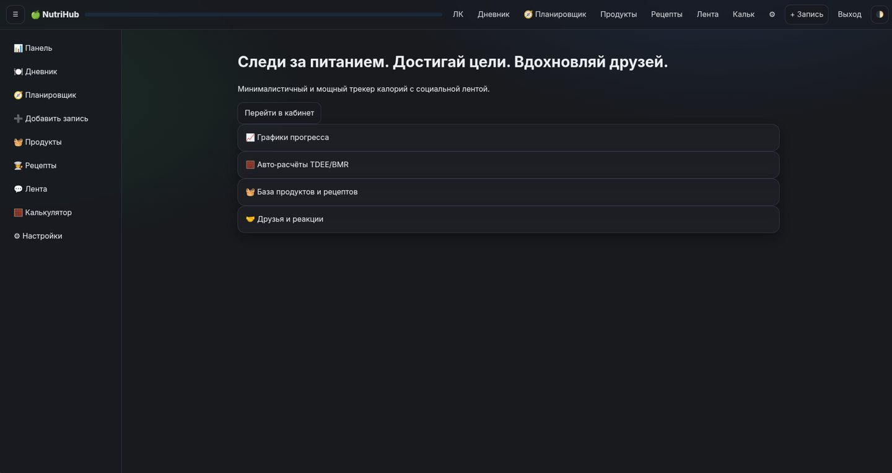
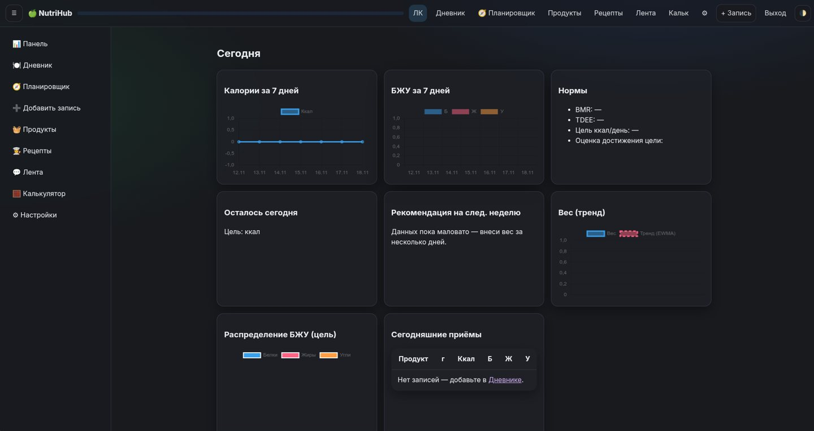
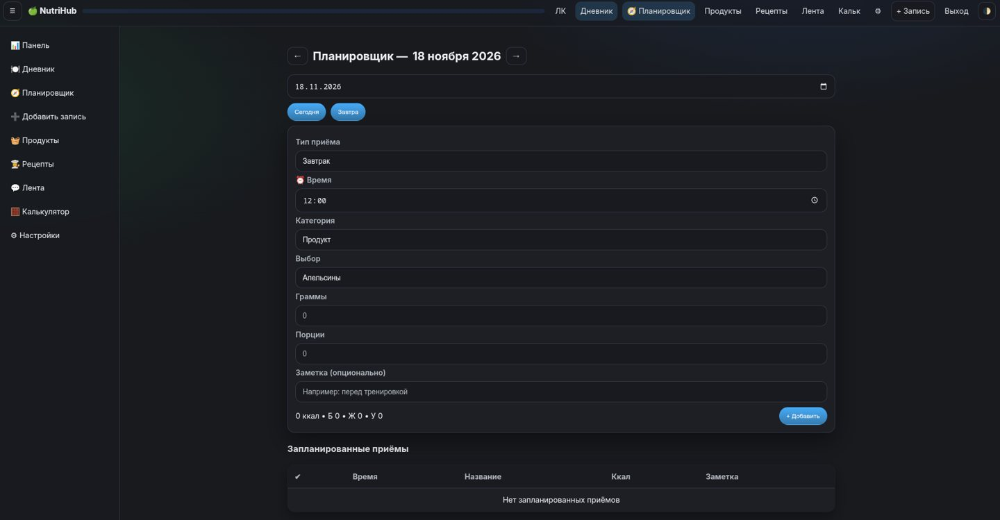
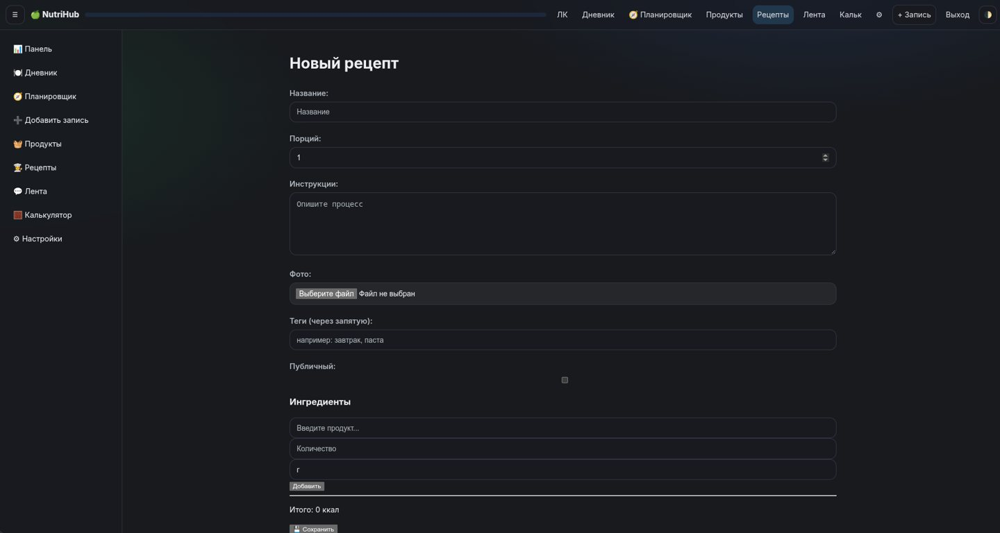
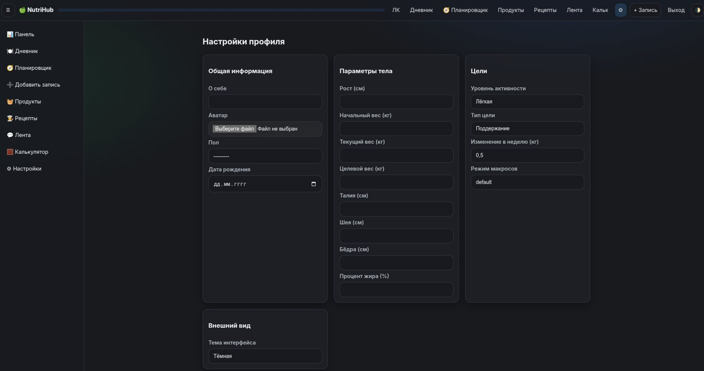

<div align="center">

# 🍏 NutriHub

### Track your nutrition. Reach your goals. Build healthier habits.

**A Django-powered food diary, meal planner, recipe book, and progress dashboard.**

[](https://github.com/SMETAHA/nutrihub/actions/workflows/ci.yml)
[](LICENSE)
[](https://www.python.org/)
[](https://www.djangoproject.com/)
[](README.ru.md)

[English](README.md) · [Русский](README.ru.md)

</div>

<p align="center">
  
</p>

<table>
<tr>
<td width="58%">

NutriHub brings everyday nutrition tracking together in one place. Log meals, build recipes from ingredients, plan what is next, and review your calorie and weight trends.

The interface supports **English and Russian**. English is the default; switch languages any time with the `RU` / `EN` button in the top navigation.

</td>
<td width="42%">

#### At a glance

- Personal food diary with calorie and macro totals
- Searchable food catalog and custom recipes
- Day-by-day meal planner
- Weight trends and nutrition dashboard
- BMR, TDEE, and macro estimates
- Community feed, friends, and reactions
- CSV, PDF, and Markdown exports
- Token-authenticated REST API

</td>
</tr>
</table>

## Screenshots

<table>
<tr>
<td width="50%">
<strong>Progress dashboard</strong><br>

</td>
<td width="50%">
<strong>Food diary archive</strong><br>

</td>
</tr>
<tr>
<td width="50%">
<strong>Meal planner</strong><br>

</td>
<td width="50%">
<strong>Recipe editor</strong><br>

</td>
</tr>
<tr>
<td width="50%">
<strong>Profile and goals</strong><br>

</td>
<td width="50%">

Screenshots show the application UI. Your data stays yours: the screenshots contain only the demo interface and no repository database.

</td>
</tr>
</table>

## Features

### Nutrition tracking

- Log foods and recipes by weight or serving.
- See calories, protein, fat, and carbohydrates for each entry.
- Review a monthly calendar and daily summaries.
- Export a day or month as CSV or PDF; export a day as Markdown.

### Recipes and meal planning

- Build recipes from the food catalog.
- Add ingredients by grams, millilitres, or pieces.
- Estimate recipe nutrition per serving and per 100 g.
- Plan meals in advance and transfer them to the diary.

### Goals and progress

- Estimate BMR using Mifflin–St Jeor, Harris–Benedict, Katch–McArdle, or Cunningham.
- Estimate TDEE and a daily calorie target.
- Track body measurements and weight history.
- Visualize recent calories, macros, and weight trends.

> Nutrition calculations are estimates for informational purposes, not medical advice.

### Community

- Share short posts with friends.
- React to posts and explore a lightweight activity feed.

## Tech stack

| Area | Stack |
|---|---|
| Backend | Python 3.11–3.13, Django 5 |
| Database | SQLite locally; PostgreSQL in Docker |
| UI | Django Templates, HTML, CSS, JavaScript |
| API | Django REST Framework, session and token authentication |
| Search / exports | RapidFuzz, ReportLab |
| Deployment | Docker Compose, Gunicorn, WhiteNoise |
| CI | GitHub Actions |

## Quick start

### Requirements

- Python 3.11–3.13
- pip

### Local development

```bash
git clone https://github.com/SMETAHA/nutrihub.git
cd nutrihub

python -m venv .venv
source .venv/bin/activate
# Windows: .venv\Scripts\activate

python -m pip install --upgrade pip
python -m pip install -r requirements.txt
cp .env.example .env

python manage.py migrate
python manage.py createsuperuser
python manage.py runserver
```

Open [http://127.0.0.1:8000/](http://127.0.0.1:8000/). The site starts in English. Use the language button in the top bar to switch to Russian; the choice is remembered in a cookie.

### Load sample foods (optional)

```bash
python manage.py loaddata fixtures/products.sample.json
```

## Docker

The Compose stack starts the web application and PostgreSQL:

```bash
export DJANGO_SECRET_KEY="$(python -c 'from django.core.management.utils import get_random_secret_key; print(get_random_secret_key())')"
docker compose up --build -d
docker compose exec web python manage.py createsuperuser
```

Open [http://localhost:8000/](http://localhost:8000/). The container runs database migrations and collects static assets on startup.

Before deploying publicly, configure a strong secret, allowed hosts, HTTPS, backups, and persistent media storage. See [docs/DOCKER.md](docs/DOCKER.md).

## REST API

All API routes are under `/api/`. Obtain a token with:

```bash
curl -X POST http://127.0.0.1:8000/api/auth/token/ \
  -d "username=<username>" \
  -d "password=<password>"
```

Then send `Authorization: Token <token>` with requests.

| Endpoint | Purpose |
|---|---|
| `/api/products/` | Search and manage products |
| `/api/recipes/` | Manage recipes and ingredients |
| `/api/diary/` | Manage your food diary |
| `/api/planned-meals/` | Manage your meal plan |

List endpoints are paginated (`count`, `next`, `previous`, `results`). Diary and planner records are scoped to the authenticated user; private products and recipes are visible only to their owners.

## Languages

NutriHub uses Django's built-in internationalization system:

- `en` — default interface language;
- `ru` — Russian translation;
- language switch — a POST to Django's `set_language` view, persisted in a cookie.

To update translation files after changing marked strings:

```bash
python manage.py makemessages -l ru
python manage.py compilemessages
```

## Checks and tests

```bash
python manage.py check
python manage.py test
```

## Project layout

```text
accounts/       authentication and user profiles
api/            REST API serializers, permissions, and endpoints
core/           dashboard, calculator, and shared utilities
diary/          meal entries, weight history, and planner
products/       food catalog and portions
recipes/        recipes and ingredients
socialfeed/     friends, posts, reactions, notifications
templates/      Django templates
static/         CSS and JavaScript
locale/         translated message catalogs
docs/           deployment docs and screenshots
```

## Contributing

Bug reports and pull requests are welcome. Please read [CONTRIBUTING.md](CONTRIBUTING.md) and [CODE_OF_CONDUCT.md](CODE_OF_CONDUCT.md) before contributing.

## Security

Do not post credentials, personal health information, or vulnerability details in public issues. Report security issues privately using GitHub's **Report a vulnerability** option. See [SECURITY.md](SECURITY.md).

## License

NutriHub is available under the [MIT License](LICENSE).

<div align="center">

**[Issues](https://github.com/SMETAHA/nutrihub/issues) · [Discussions](https://github.com/SMETAHA/nutrihub/discussions) · [Contributing](CONTRIBUTING.md)**

</div>
