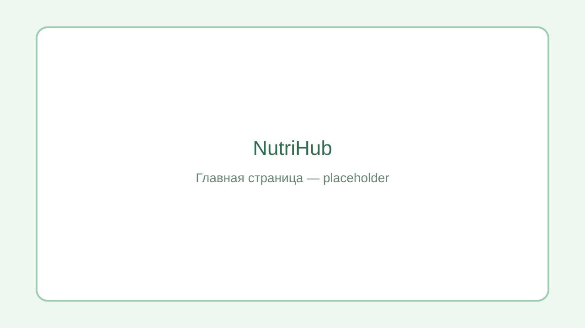
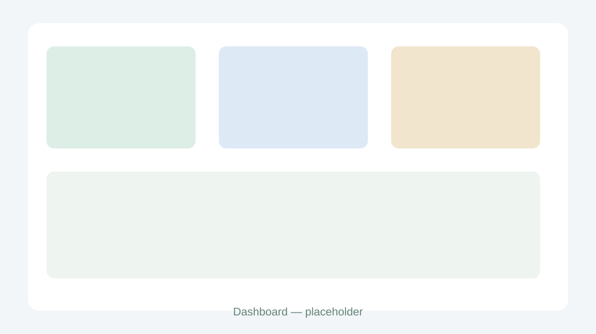
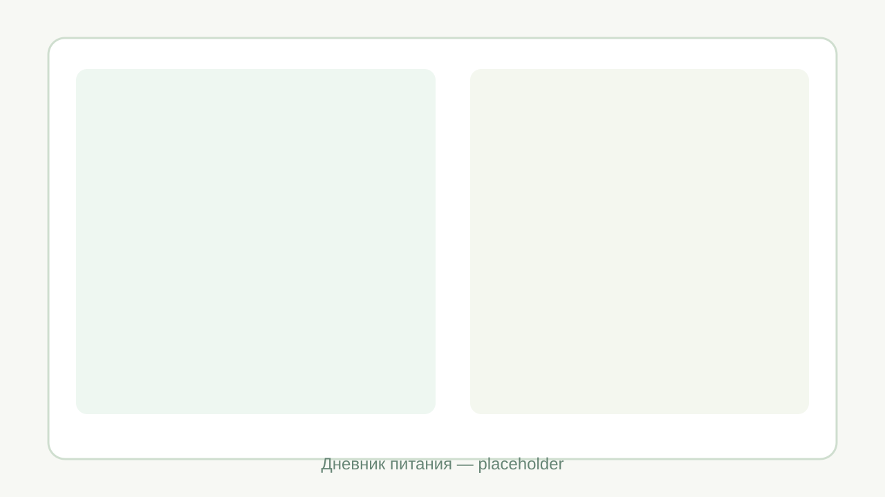
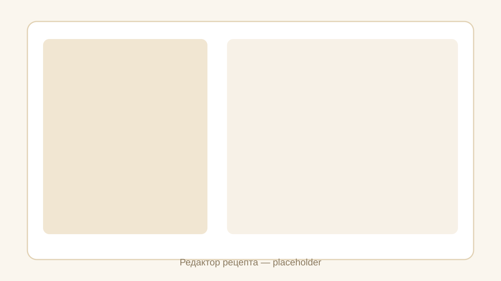

<div align="center">

# NutriHub

**Современный трекер питания, дневник калорий и личный планировщик здоровья**

[](https://github.com/SMETAHA/nutrihub/actions)
[](LICENSE)
[](https://www.python.org/)
[](https://www.djangoproject.com/)
[](CONTRIBUTING.md)

</div>

<table>
<tr>
<td width="65%">

NutriHub помогает вести дневник питания, планировать приёмы пищи, считать калории и макронутриенты, анализировать динамику веса и общаться с другими пользователями.

Проект построен на Django и подходит как для локального демо, так и для дальнейшего превращения в полноценный продукт.

</td>
<td width="35%">

### Ключевые возможности

- Дневник калорий и БЖУ
- База продуктов с поиском
- Рецепты и расчёт порций
- Планировщик питания
- BMR/TDEE и цели по весу
- Графики веса и прогресса
- Социальная лента
- Экспорт CSV, PDF и Markdown

</td>
</tr>
</table>

---

## Скриншоты

> Добавьте реальные изображения интерфейса перед релизом.

| Главная страница | Личный dashboard |
|:---:|:---:|
|  |  |

| Дневник питания | Редактор рецепта |
|:---:|:---:|
|  |  |

## Возможности

### Управление питанием

- Добавляйте продукты в дневник с указанием веса в граммах.
- Создавайте рецепты из базы продуктов.
- Пересчитывайте калорийность и БЖУ на порцию или произвольный вес.
- Планируйте завтрак, обед, ужин или перекус.
- Переносите запланированную еду в дневник.
- Просматривайте статистику за день и календарь месяца.

### Аналитика здоровья

- Рассчитывайте базовый обмен веществ по нескольким методам:
  - Mifflin-St Jeor;
  - Harris-Benedict;
  - Katch-McArdle;
  - Cunningham.
- Определяйте TDEE и суточную калорийную цель.
- Сохраняйте параметры профиля и параметры цели.
- Отмечайте динамику веса.
- Получайте рекомендации по распределению белков, жиров и углеводов.

### Социальные функции

- Создавайте посты в ленте.
- Добавляйте других пользователей в друзья.
- Оставляйте реакции на публикации.
- Просматривайте уведомления.

### Экспорт

- CSV для Excel и таблиц;
- PDF с поддержкой кириллицы;
- Markdown для заметок и документации.

## Технологии

| Слой | Технологии |
|---|---|
| Backend | Python 3.11–3.13, Django 5.x |
| База данных | SQLite для разработки, PostgreSQL для Docker-продакшена |
| Frontend | Django Templates, HTML, CSS, JavaScript |
| Изображения | Pillow |
| Поиск | RapidFuzz |
| PDF | ReportLab |
| Инфраструктура | Docker, Docker Compose, GitHub Actions |

## Структура проекта

```text
nutrihub/
├── accounts/        # Пользователи, профиль, цели и темы
├── core/            # Главная, dashboard и калькуляторы
├── diary/           # Записи питания, вес и планировщик
├── products/        # База продуктов и порций
├── recipes/         # Рецепты и ингредиенты
├── socialfeed/      # Друзья, лента и реакции
├── static/          # CSS и статические ресурсы
├── templates/       # Django-шаблоны
├── fixtures/        # Примерные и демонстрационные данные
├── docs/            # Документация и изображения
├── nutrihub/        # Настройки проекта и корневые маршруты
├── db.sqlite3       # Локальная база разработки
├── manage.py
└── requirements.txt
```

## Быстрый старт

### Требования

- Python 3.11–3.13;
- pip;
- виртуальное окружение;
- Git.

### Установка

```bash
git clone https://github.com/SMETAHA/nutrihub.git
cd nutrihub

python -m venv .venv
source .venv/bin/activate
# Windows: .venv\Scripts\activate

python -m pip install --upgrade pip
python -m pip install -r requirements.txt

cp .env.example .env
python manage.py migrate
python manage.py createsuperuser
python manage.py runserver
```

Приложение будет доступно по адресу:

```text
http://127.0.0.1:8000/
```

### Демонстрационные данные

```bash
python manage.py loaddata fixtures/products.sample.json
python manage.py loaddata fixtures/demo_content.sample.json
```

> `fixtures/demo_content.sample.json` может содержать пример пользователей или ссылаться на медиафайлы. Проверьте файл перед загрузкой в общем окружении.

## Основные маршруты

| Маршрут | Назначение |
|---|---|
| `/` | Главная страница |
| `/accounts/register/` | Регистрация |
| `/accounts/login/` | Вход |
| `/dashboard/` | Личный dashboard |
| `/diary/` | Дневник питания |
| `/diary/planner/` | Планировщик приёмов пищи |
| `/products/` | База продуктов |
| `/recipes/` | Рецепты |
| `/feed/` | Социальная лента |
| `/calculator/` | Калькулятор BMR/TDEE |
| `/settings/` | Профиль и настройки |
| `/admin/` | Административная панель |

## REST API

API доступен по префиксу `/api/` и поддерживает:

| Метод | Эндпоинт | Назначение |
|---|---|---|
| `POST` | `/api/auth/token/` | Получить токен пользователя |
| `GET`, `POST` | `/api/products/` | Список и создание продуктов |
| `GET`, `PUT`, `PATCH`, `DELETE` | `/api/products/{id}/` | Управление продуктом |
| `GET`, `POST` | `/api/recipes/` | Список и создание рецептов |
| `GET`, `PUT`, `PATCH`, `DELETE` | `/api/recipes/{id}/` | Управление рецептом |
| `GET`, `POST` | `/api/diary/` | Записи дневника |
| `GET`, `PUT`, `PATCH`, `DELETE` | `/api/diary/{id}/` | Управление записью |
| `GET`, `POST` | `/api/planned-meals/` | Запланированные приёмы |
| `GET`, `PUT`, `PATCH`, `DELETE` | `/api/planned-meals/{id}/` | Управление планом |

Аутентификация поддерживает session и token authentication:

```bash
curl -X POST http://127.0.0.1:8000/api/auth/token/ \
  -d "username=<username>" \
  -d "password=<password>"

curl -H "Authorization: Token <token>" \
  http://127.0.0.1:8000/api/products/
```

Ответы постраничных списков используют стандартный формат Django REST Framework:
`count`, `next`, `previous` и `results`.

## Конфигурация

Для разработки скопируйте файл `.env.example` и измените значения:

```dotenv
DJANGO_DEBUG=True
DJANGO_SECRET_KEY=replace-with-a-long-random-secret
DJANGO_ALLOWED_HOSTS=127.0.0.1,localhost
DATABASE_URL=sqlite:///db.sqlite3
```

Никогда не публикуйте реальный `DJANGO_SECRET_KEY`, токены, пароли или данные пользователей.

## Docker

```bash
docker compose up --build -d
docker compose exec web python manage.py migrate
docker compose exec web python manage.py createsuperuser
```

Остановка:

```bash
docker compose down
```

Подробности: [docs/DOCKER.md](docs/DOCKER.md).

## Тестирование

```bash
python manage.py check
python manage.py test
```

Перед релизом рекомендуется добавить тесты для:

- расчётов калорий и БЖУ;
- прав доступа к дневнику;
- создания и редактирования рецептов;
- регистрации и профиля;
- экспорта;
- планировщика;
- социальной ленты.

## Безопасность

Пожалуйста, не публикуйте уязвимости в публичных issues.

- Сообщайте о проблеме приватно через GitHub Security Advisories.
- Не размещайте ключи или пароли в репозитории.
- Используйте отдельные секреты для разработки и production.
- Не используйте демонстрационную SQLite-базу в публичном сервисе.

Подробности: [SECURITY.md](SECURITY.md).

## Участие в разработке

1. Сделайте Fork репозитория.
2. Создайте ветку: `git switch -c feature/my-feature`.
3. Внесите изменения.
4. Запустите проверки:
   ```bash
   python manage.py check
   python manage.py test
   ruff check .
   ```
5. Откройте Pull Request.

Рекомендации по оформлению кода и commits: [CONTRIBUTING.md](CONTRIBUTING.md).

## Лицензия

Проект распространяется по лицензии MIT. Подробности в файле [LICENSE](LICENSE).

## Roadmap

- [ ] Расширить набор автоматических тестов.
- [ ] Перевести settings на полноценную переменную окружения с безопасными defaults.
- [ ] Добавить PostgreSQL и production-конфигурацию.
- [ ] Добавить пагинацию и индексы.
- [ ] Улучшить мобильный интерфейс.
- [ ] Добавить восстановление и смену пароля.
- [ ] Добавить API для мобильного приложения.
- [ ] Подключить внешнюю базу продуктов.
- [ ] Добавить PWA или мобильный клиент.

---

<div align="center">

Разработано для удобного контроля питания и здоровых привычек.

**[Веб-сайт](https://github.com/SMETAHA/nutrihub) · [Issues](https://github.com/SMETAHA/nutrihub/issues) · [Pull Requests](https://github.com/SMETAHA/nutrihub/pulls)**

</div>
